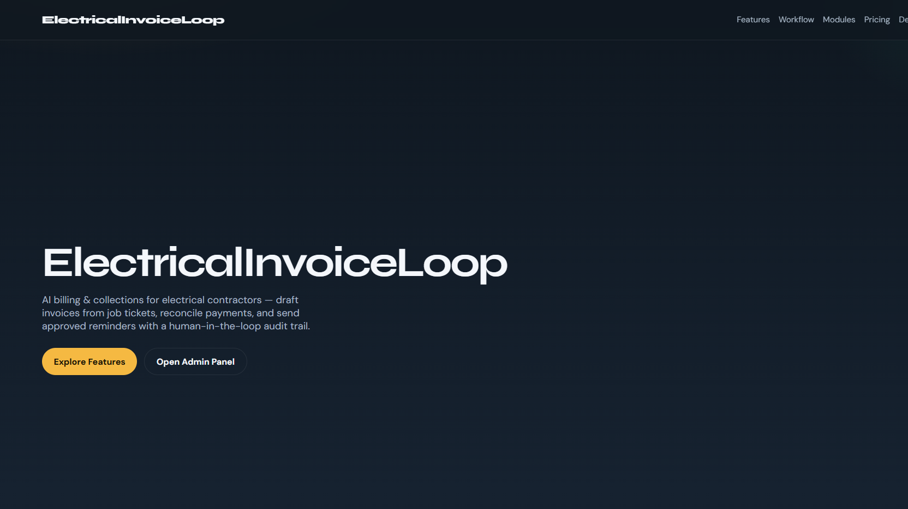
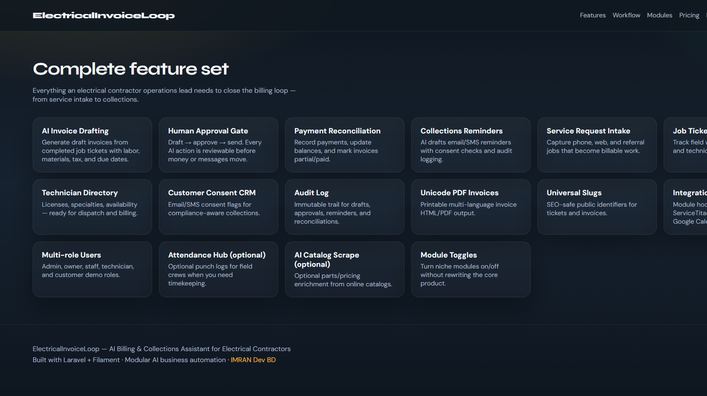
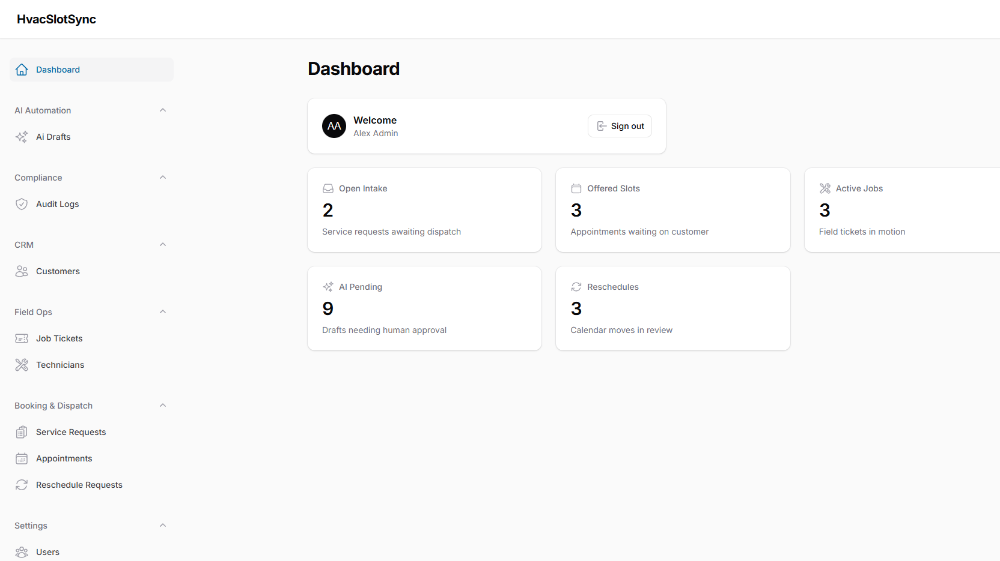
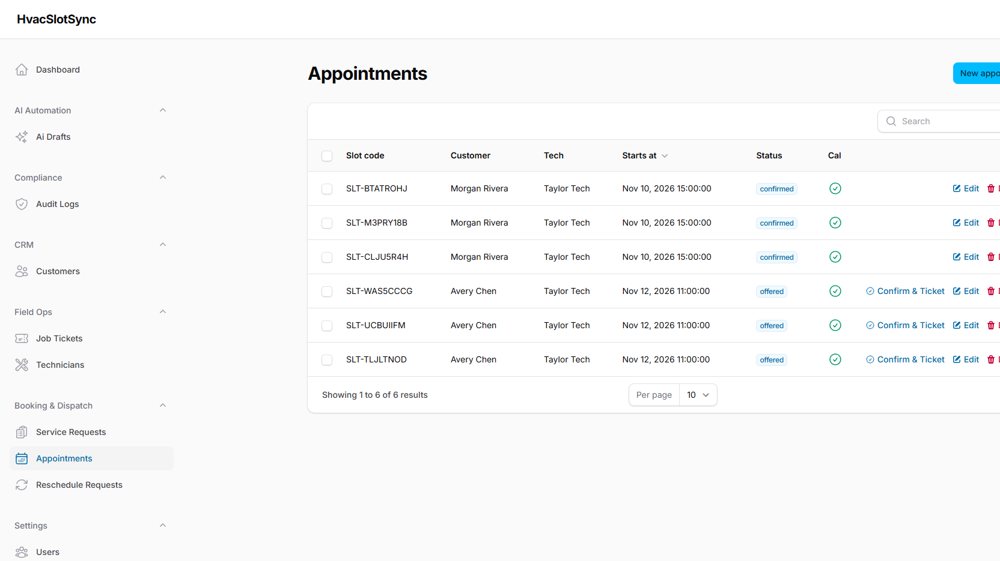

# ElectricalDemandLens — AI Demand & Capacity Forecaster for Electrical Contractors

**ElectricalDemandLens** is a world-class Laravel + Filament SaaS for electrical contractors who need to **forecast weekly workload**, **plan electrician capacity**, and **operate on service requests, field technicians, and job tickets** — with AI drafts, human approval, and compliance audit logs.

> SEO H1: ElectricalDemandLens AI Electrical Demand Forecasting Software | Capacity Planner | Workload Forecaster | ServiceTitan Jobber Planning Automation

## Why electrical owners buy ElectricalDemandLens

- Forecast next week’s jobs and labor hours from historical + open demand
- Match licensed electrician capacity to surge risk before Monday starts
- Approve AI staffing drafts with an immutable audit trail
- Toggle modules on/off so each electrical business runs only what it needs
- Integrate Jobber, ServiceTitan, QuickBooks, and Google Calendar when ready

## Related keywords / tags

electrical demand forecasting, electrical capacity planning, electrician workload forecaster, electrical resource planning, electrical ops software, electrical contractor SaaS, field service capacity, technician utilization, weekly job forecast, storm outage surge planning, EV charger install capacity, panel upgrade staffing, ServiceTitan alternative planning, Jobber demand analytics, QuickBooks labor forecast, Google Calendar capacity sync, AI business automation, Laravel Filament admin, modular SaaS, multi-role electrical CRM, home & field services planning, licensing and safety compliance, SMS consent messaging, attendance-driven capacity, Unicode PDF forecast packs, AI catalog scrape, ops forecast portal, residential wiring forecast, generator install capacity, lighting retrofit planning

## Core workflow (MVP)

1. **Intake trigger** — service requests / job history enter the demand funnel  
2. **AI draft / action** — weekly forecast + capacity plan drafted with surge risk  
3. **Human approval** — owner / ops lead approves before publish  
4. **Audit log** — every action recorded for compliance

## Feature modules

| Module | Default | Purpose |
| --- | --- | --- |
| Demand Intake | ON | Capture demand signals from phone/web/Jobber/ServiceTitan |
| Weekly Demand Forecast | ON | Project jobs/hours by day, type, ZIP |
| Capacity Planner | ON | Assign electrician hours vs projected demand |
| Resource Gap Alerts | ON | Flag shortfalls and overtime risk |
| AI Forecast Assist | ON | Draft forecasts and staffing recommendations |
| Human Approval Gate | ON | Require approval before publish |
| Audit Log | ON | Immutable compliance trail |
| Google Calendar Sync | ON | Mirror capacity windows |
| Jobber Integration | OFF | Pull historical jobs |
| ServiceTitan Integration | OFF | Mirror jobs & rosters |
| QuickBooks Sync | OFF | Labor/revenue forecast hooks |
| Technician Attendance Hub | ON | Real capacity from check-ins |
| SMS Consent Messaging | ON | Consent-aware staffing notices |
| Unicode PDF Forecast Packs | ON | Multi-language weekly packs |
| Universal Slug Pages | OFF | Multi-language SEO landings |
| AI Catalog Scrape | OFF | Seasonal/equipment demand features |
| Ops Forecast Portal | ON | Owner/dispatcher review UI |
| Licensing & Safety Checks | ON | Count only licensed electricians for high-risk work |

## Demo users

Password for all accounts: `password`

| Role | Email | Access |
| --- | --- | --- |
| Admin | admin@electricaldemandlens.test | Full panel + modules |
| Owner | owner@electricaldemandlens.test | Approvals & ops |
| Staff / Planner | staff@electricaldemandlens.test | Intake, forecasts, capacity |
| Technician | tech@electricaldemandlens.test | Field / tickets |
| Customer | customer@electricaldemandlens.test | Demo portal identity |

## Docker run

```bash
cd pipeline/apps/ElectricalDemandLens
docker compose up -d --build
```

- App: http://localhost:8145  
- Admin: http://localhost:8145/admin  
- MySQL host port: `33145`  
- Redis host port: `63845`

## Screenshots






## Tech stack

- PHP 8.4 · Laravel 13 · Filament 4
- MySQL 8.4 · Redis 7
- Docker Compose
- Modular feature flags (`config/modules.php` + `feature_modules` table)
- Local AI forecast services (Packagist `imrandevbd/*` packages unavailable at stable; equivalents shipped in-app)

## Public pages

- `/` — marketing home  
- `/features` — product capabilities  
- `/modules` — toggleable module catalog  
- `/how-it-works` — MVP intake → draft → approval → audit  
- `/pricing` — pilot pricing hypothesis  
- `/demo` — demo credentials  
- `/admin` — Filament admin

## Contact / Hire

- Developer: Imran Ahmed (IMRAN Dev BD)
- Website: https://imrandev.bd/contact
- Email: me@imrandev.bd
- GitHub: https://github.com/imranbru99
